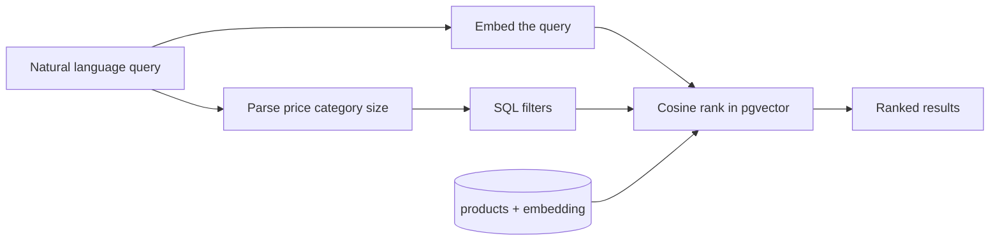

# Semantic Shop

A small e-commerce catalog where search understands a sentence and still obeys hard constraints.

Ask for “large boots under $70” and the app does two things at once: it ranks products by meaning, and it filters price, category, size, and stock in SQL. Embeddings are stored next to the product row in Postgres (`pgvector`), not in a separate search service.

There is no cart, checkout, or accounts. The point is the search path: natural language in, hybrid query out.

## How search works



On create or update, the API embeds `name`, `brand`, `category`, and `description` and stores a 1536-dimension vector on the same row. Search embeds the query, applies the structured filters, then orders by cosine distance.

The storefront also reads constraints out of the sentence (`under $70`, `greater than 30`, `boots`, `large`) and fills the filter bar. You can still override those filters by hand.

Example queries:

- `lightweight summer jacket for rainy weather under $80`
- `large boots price less than 70 but greater than 30 usd`

## Stack

| Piece | Choice |
| --- | --- |
| Storefront | Next.js (App Router), TypeScript |
| API | FastAPI |
| Database | PostgreSQL 16 + pgvector |
| Embeddings | OpenAI `text-embedding-3-small` |

## Prerequisites

- Docker
- Node.js 20+
- An OpenAI API key

## Run it

```bash
cp .env.example .env
# set OPENAI_API_KEY in .env

docker compose up -d --build
docker compose exec api python -m app.reindex --only-missing

cd apps/web
cp .env.example .env.local
npm install
npm run dev
```

- Storefront: http://localhost:3000
- API: http://localhost:8000
- OpenAPI: http://localhost:8000/docs
- Postgres from the host: `localhost:5434` (user/password/db: `semantic` / `semantic` / `semantic_shop`)

`docker compose up` runs migrations and loads the seed catalog if the table is empty. Products are searchable only after `reindex`, which calls OpenAI and writes the vectors. The seed is about 70 products, so the first reindex is a small embedding bill.

Stop the backend with `docker compose down`. Catalog data stays in the Docker volume until you remove it.

### Useful commands

```bash
docker compose logs -f api
docker compose restart api
docker compose exec api python -m app.reindex            # re-embed everything
docker compose exec api python -m app.seed --reset       # wipe and reload the seed
```

### Run the API on the host instead

Use this if you want hot reload. Postgres still comes from Compose.

```bash
docker compose up -d db
cd apps/api
python -m venv .venv && source .venv/bin/activate
pip install -r requirements.txt
alembic upgrade head && python -m app.seed
python -m app.reindex --only-missing
uvicorn app.main:app --reload --port 8000
```

`DATABASE_URL` in `.env` already points at `localhost:5434`. Compose overrides that inside the API container so it talks to the `db` service.

## Try the demo

1. Search from an empty box. Filters should fill in from the sentence.
2. Open a result and check the match score.
3. In Admin (`/admin/products`), add a product with unusual wording.
4. Search again with different words that mean the same thing. The new product should rank from the embedding, not from a keyword match.

Admin has no login. It exists so you can watch embed-on-write.

## API

Interactive docs: http://localhost:8000/docs

| Method | Path | What it does |
| --- | --- | --- |
| `GET` | `/health` | Database check |
| `POST` | `/products` | Create a product and embed it |
| `GET` | `/products` | List products |
| `GET` | `/products/{id}` | Product detail |
| `PATCH` | `/products/{id}` | Update; re-embeds when text changes |
| `DELETE` | `/products/{id}` | Delete |
| `POST` | `/search` | Embed the query, apply SQL filters, rank by similarity |

```json
{
  "query": "lightweight summer jacket for rainy weather under $80",
  "max_price": 80,
  "category": "jackets",
  "in_stock_only": true,
  "limit": 10
}
```

If the embedding call fails, the product is still saved and `embedding_pending` is true. Search ignores rows with no vector.

## Layout

```text
apps/web    Next.js storefront
apps/api    FastAPI, Alembic, seed data, reindex
```

`docker-compose.yml` runs Postgres and the API.

## Not in this repo

Cart, payments, authentication, and a production deploy. Embeddings run inline on write; a queue would be the next step if the catalog were large.
